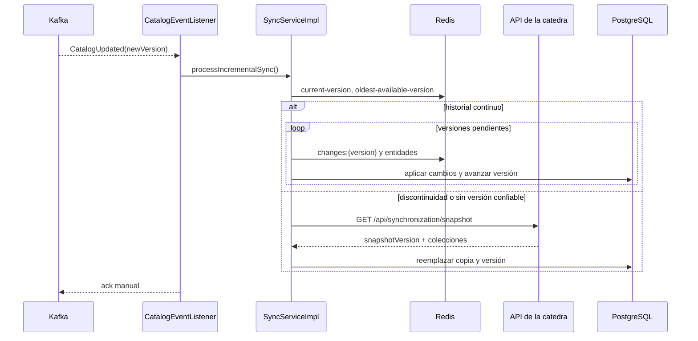

# Arquitectura del servicio de catálogo

## 1. Objetivo

Este documento describe la arquitectura de `Servicio-catalogo`, sus responsabilidades, límites y relaciones con el resto del sistema. Es el servicio local vigente para categorías, profesionales y horarios semanales.

## 2. Contexto

```mermaid
flowchart LR
  TURNOS[servicio-turnos] -->|HTTP + JWT SERVICE| CATALOGO
  CATALOGO[Servicio-catalogo :8081] --> DB[(PostgreSQL catalogo_db)]
  CATEDRA_API[API REST de la catedra] -->|GET snapshot| CATALOGO
  CATEDRA_REDIS[(Redis catedra:sync)] -->|versiones y cambios| CATALOGO
  CATEDRA_KAFKA[Kafka catedra.catalog.{groupId}] -->|CatalogUpdated| CATALOGO
```

El servicio central de la catedra es la fuente autoritativa remota. Este servicio mantiene una copia local para que las búsquedas y la construcción de disponibilidad no dependan de la catedra.

`servicio-turnos` consume este catálogo por HTTP usando un JWT de rol `SERVICE`. La app KMP no consulta directamente la catedra.

## 3. Responsabilidades

### Dentro del alcance

- Almacenar localmente categorías, profesionales y horarios semanales.
- Conservar la versión de catálogo aplicada.
- Ejecutar sincronización completa por snapshot y sincronización incremental.
- Detectar discontinuidades y reconstruir la copia local.
- Buscar y filtrar profesionales usando solo datos locales.
- Exponer el estado de sincronización y errores de integración.
- Validar JWT en sus propios endpoints.

### Fuera del alcance

- Usuarios finales, registro, login o emisión de JWT.
- Reservas, holds, disponibilidad por fecha u ocupaciones.
- Consumir los topics Kafka de turnos.
- Replicar el catálogo dentro de `servicio-turnos`.
- Escritura en Redis: la ACL de la catedra permite namespaces propios, pero este servicio hoy solo consume `catedra:sync:*`.

## 4. Componentes

| Capa | Componentes | Responsabilidad |
| --- | --- | --- |
| API REST | `CategoryController`, `ProfessionalController`, `CatalogVersionController`, `SyncController` | Exponer lectura local y operaciones de sincronización. |
| Errores | `GlobalExceptionHandler` | Convertir fallos a `ProblemDetail` con `code` funcional. |
| Consulta | `CatalogServiceImpl`, `CatalogMapper`, `ProfessionalSpecifications` | Búsquedas sobre la copia local, sin llamadas a la catedra. |
| Sincronización | `SyncServiceImpl`, `SyncStatusService` | Snapshot, incrementales, transacciones, versión local y estado. |
| Cliente externo | `CatedraApiClient`, `RestClientConfig` | Obtener el snapshot REST con el JWT técnico. |
| Redis | `RedisConfig`, `RedisSyncRepository` | Leer versiones, cambios y entidades publicadas por la catedra. |
| Kafka | `KafkaConsumerConfig`, `CatalogEventListener` | Consumir `CatalogUpdated` con ack manual y deduplicación. |
| Arranque y periodicidad | `SyncBootstrap`, `CatalogReconciliationJob` | Snapshot inicial y reconciliación de eventos perdidos. |
| Configuración | `CatedraProperties`, `CorsConfig`, `JacksonConfig` | Propiedades de integración, CORS y serialización. |
| Seguridad | `SecurityConfig`, `SecurityProperties`, `RolesJwtAuthenticationConverter` | Resource server JWT, roles y CORS. |

## 5. Flujo de sincronización simplificado



El detalle está en [`sync-strategy.md`](sync-strategy.md) y [`idempotency-and-recovery.md`](idempotency-and-recovery.md).

## 6. Propiedad de los datos

| Sistema | Datos que posee | Observaciones |
| --- | --- | --- |
| Catedra | Catálogo autoritativo, Redis `catedra:sync:*`, topics Kafka y reservas centrales | No es propiedad de este repositorio. |
| Servicio-catalogo | Copia local en PostgreSQL, versión aplicada, eventos Kafka procesados | Es el único dueño de estas tablas. |
| Servicio-turnos | Usuarios finales, procesos, reservas y estados locales | No comparte base con este servicio. |

No se usa una base compartida ni acceso directo a repositorios de otro servicio como mecanismo de integración.

## 7. Despliegue y configuración

- Aplicación Spring Boot única que escucha en el puerto `8081`.
- PostgreSQL externo gestionado con Flyway; `ddl-auto: none`.
- Redis y Kafka son servicios administrados por la catedra.
- Los valores de conexión y secretos se pasan por variables de entorno.
- `compose.yaml` levanta PostgreSQL en `5433` y expone healthcheck para uso local.

La configuración de integración se deriva de `CATEDRA_GROUP_ID` cuando no se informan valores explícitos:

| Valor | Formato derivado |
| --- | --- |
| Topic Kafka de catálogo | `catedra.catalog.{groupId}` |
| Consumer group | `alumnos-{groupId}` |
| Namespace Redis de escritura | `alumnos:{groupId}:*` |

Los valores explícitos tienen prioridad.

## 8. Decisiones relevantes

- La búsqueda se resuelve siempre contra la copia local.
- Kafka notifica; los datos se leen de Redis o del snapshot REST.
- El listener solo se registra si Kafka está habilitado y existe `groupId` o un topic explícito.
- El snapshot inicial se omite si `provisioningStatus` está informado y no es `PROVISIONED`.
- El listener también omite eventos cuando el provisioning está bloqueado y solo confirma el offset si la versión local alcanzó `newVersion`.
- Redis usa timeouts de conexión y comando de 2 segundos para no bloquear la reconciliación.
- Kafka soporta `PLAINTEXT`, `SSL`, `SASL_PLAINTEXT` y `SASL_SSL` mediante variables de entorno; el cliente es propio de este servicio.
- Tras agotar los reintentos, el evento fallido se publica en `{catalogTopic}.dlt`, configurable con `CATEDRA_KAFKA_DLT_TOPIC`.
- La comunicación con `servicio-turnos` usa JWT de servicio; el token técnico de la catedra nunca se propaga.
- No existe un controlador interno separado: se reutilizan los endpoints `/api/**` documentados en [`contract-catalogo-turnos.md`](contract-catalogo-turnos.md).

## 9. Stack

- Java 25 y Gradle.
- Spring Boot 4.1.1: Web MVC, Data JPA, Data Redis, Kafka, Security, Validation.
- PostgreSQL y Flyway.
- Jackson con módulo Java Time.
- H2 solo en tests.
- JUnit 5, Mockito, AssertJ, MockMvc.
