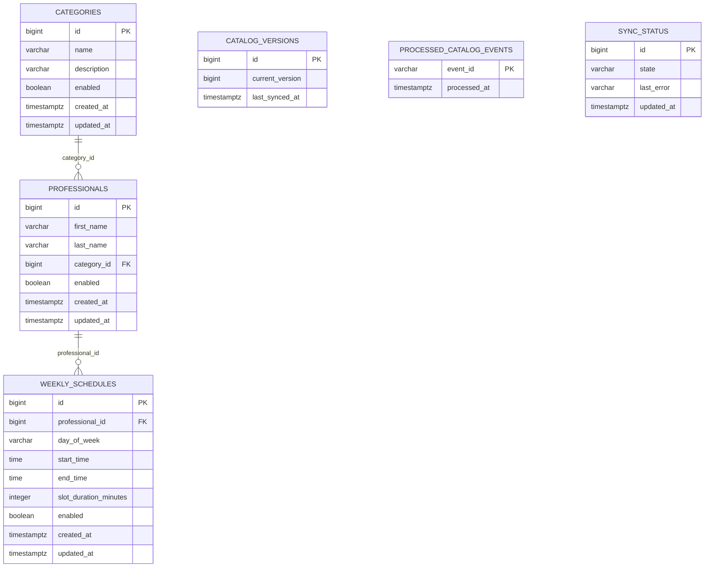

# Modelo de datos del catálogo

## 1. Propiedad

Todas las tablas de este documento pertenecen a `Servicio-catalogo`. No hay tablas compartidas con `servicio-turnos` ni con la catedra.

La catedra es la fuente autoritativa externa, pero este servicio solo consume su API REST, Redis y Kafka. No accede a bases de la catedra.

La base local se administra con Flyway. Las migraciones actuales son `V1__init_catalog.sql`, `V2__index_processed_catalog_events.sql` y `V3__sync_status_and_cleanup.sql`; Hibernate está configurado con `ddl-auto: none`.

## 2. Diagrama

## 3. Tablas

### `categories`

Categorías profesionales copiadas del snapshot o de los cambios incrementales.

| Columna | Tipo | Restricción | Descripción |
| --- | --- | --- | --- |
| `id` | `bigint` | PK | ID de la catedra. |
| `name` | `varchar(255)` | NOT NULL | Nombre de la categoría. |
| `description` | `varchar(1000)` | nullable | Descripción opcional. |
| `enabled` | `boolean` | NOT NULL | Alta lógica. |
| `created_at` | `timestamptz` | NOT NULL | Fecha informada por la catedra. |
| `updated_at` | `timestamptz` | NOT NULL | Última actualización informada por la catedra. |

### `professionals`

Profesionales de la copia local.

| Columna | Tipo | Restricción | Descripción |
| --- | --- | --- | --- |
| `id` | `bigint` | PK | ID de la catedra. |
| `first_name` | `varchar(255)` | NOT NULL | Nombre. |
| `last_name` | `varchar(255)` | NOT NULL | Apellido. |
| `category_id` | `bigint` | FK a `categories(id)` | Categoría vigente. |
| `enabled` | `boolean` | NOT NULL | Alta lógica. |
| `created_at` | `timestamptz` | NOT NULL | Fecha informada por la catedra. |
| `updated_at` | `timestamptz` | NOT NULL | Última actualización informada por la catedra. |

Índice: `idx_professionals_category` sobre `category_id`. La columna `email` de la migración inicial fue eliminada por `V3__sync_status_and_cleanup.sql` porque no pertenece al contrato.

### `weekly_schedules`

Reglas semanales de agenda. No representan turnos ni disponibilidad calculada.

| Columna | Tipo | Restricción | Descripción |
| --- | --- | --- | --- |
| `id` | `bigint` | PK | ID de la catedra. |
| `professional_id` | `bigint` | FK a `professionals(id)` | Profesional dueño del horario. |
| `day_of_week` | `varchar(10)` | NOT NULL | `MONDAY` a `SUNDAY`. |
| `start_time` | `time` | NOT NULL | Inicio local incluido. |
| `end_time` | `time` | NOT NULL | Fin local excluido. |
| `slot_duration_minutes` | `integer` | NOT NULL | Duración del slot. |
| `enabled` | `boolean` | NOT NULL | Alta lógica. |
| `created_at` | `timestamptz` | NOT NULL | Fecha informada por la catedra. |
| `updated_at` | `timestamptz` | NOT NULL | Última actualización informada por la catedra. |

Índice: `idx_weekly_schedules_professional` sobre `professional_id`.

### `catalog_versions`

Registro único con la versión local aplicada.

| Columna | Tipo | Restricción | Descripción |
| --- | --- | --- | --- |
| `id` | `bigint` | PK, siempre `1` | Singleton. |
| `current_version` | `bigint` | NOT NULL | Versión de la copia local. |
| `last_synced_at` | `timestamptz` | nullable | Última actualización aplicada. |

La versión local solo avanza cuando la transacción correspondiente termina correctamente.

### `processed_catalog_events`

Deduplicación funcional de eventos Kafka.

| Columna | Tipo | Restricción | Descripción |
| --- | --- | --- | --- |
| `event_id` | `varchar(255)` | PK | `eventId` del evento `CatalogUpdated`. |
| `processed_at` | `timestamptz` | NOT NULL | Momento en que se registró. |

`V2__index_processed_catalog_events.sql` crea un índice por `processed_at`. `ProcessedCatalogEventsCleanupJob` elimina registros anteriores a `now - processed-events-retention-days` y se puede desactivar con `CATEDRA_PROCESSED_EVENTS_CLEANUP_ENABLED=false`.

### `sync_status`

Estado local persistente de la sincronización. Es un singleton con `id = 1`, creado por `V3__sync_status_and_cleanup.sql`.

| Columna | Tipo | Restricción | Descripción |
| --- | --- | --- | --- |
| `id` | `bigint` | PK, siempre `1` | Singleton. |
| `state` | `varchar(20)` | NOT NULL | `IDLE`, `SYNCING` o `ERROR`. |
| `last_error` | `varchar(2000)` | nullable | Último mensaje de error, truncado si excede el tamaño. |
| `updated_at` | `timestamptz` | NOT NULL | Último cambio de estado. |

`SyncBootstrap.recoverInterrupted()` convierte un `SYNCING` heredado de un reinicio en `ERROR` con un mensaje explicativo.

## 4. Datos que no se almacenan aquí

- Usuarios finales o credenciales de login.
- Reservas, holds, procesos de reserva ni estados de pago.
- Ocupaciones de la catedra.
- Historial completo de versiones: Redis mantiene la ventana de cambios; la base local solo guarda la versión actual.

## 5. Bajas lógicas

Las entidades deshabilitadas permanecen en las tablas con `enabled = false`. Los endpoints de consulta aplican filtros según el contrato:

- `GET /api/categories` devuelve todas salvo que se indique `enabled`.
- `GET /api/professionals` usa `enabled = true` por defecto.
- `GET /api/professionals/{id}/schedules` devuelve solo horarios habilitados.
- `GET /api/professionals/{id}` incluye todos los horarios del profesional.

## 6. Consistencia

- El snapshot reemplaza horarios, profesionales y categorías dentro de una transacción, y actualiza `catalog_versions` al final.
- Cada versión incremental se aplica en su propia transacción y actualiza la versión local al final.
- Si una entidad referenciada por un cambio no existe, se lanza `CatalogDiscontinuityException` y se fuerza un snapshot.
- Los IDs son los de la catedra; no se generan IDs locales.
