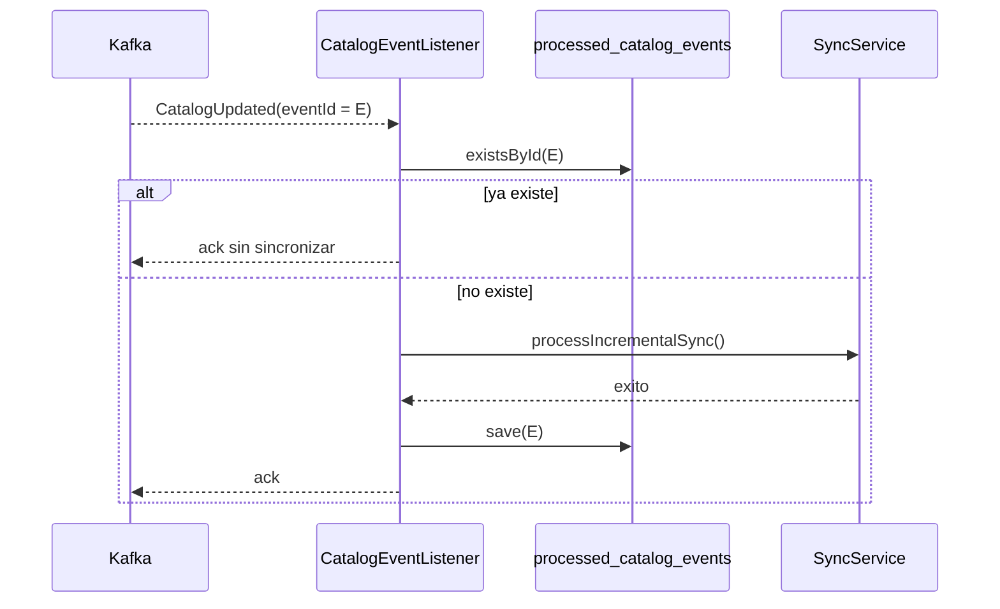

# Idempotencia y recuperación

## 1. Decisiones generales

- Kafka es una notificación; Redis y REST son la fuente de datos.
- El procesamiento se ordena por versión de catálogo, no por el orden de llegada del evento.
- Cada evento `eventId` se procesa como máximo una vez de forma funcional.
- La versión local avanza solo cuando la transacción correspondiente termina correctamente.
- Si no se puede continuar de forma segura, se reconstruye la copia con snapshot.

## 2. Mecanismos implementados

| Mecanismo | Implementación | Efecto |
| --- | --- | --- |
| Deduplicación Kafka | `processed_catalog_events` con PK `eventId` | Un evento repetido no dispara otra sincronización. |
| Lock de sincronización | `ReentrantLock` en `SyncServiceImpl` | Evita snapshot e incremental simultáneos. |
| Transacciones | `TransactionTemplate` | Snapshot e incrementales son atómicos por unidad de trabajo. |
| Control de versión | `catalog_versions.current_version` | Permite detectar atraso, adelanto y discontinuidad. |
| Validación de cambios | `CatalogDiscontinuityException` | Fuerza snapshot ante datos inconclusos o inconsistentes. |
| Ack manual | `MANUAL_IMMEDIATE` | El offset se confirma solo después de persistir. |
| Reconciliación | Job periódico | Recupera notificaciones perdidas. |

## 3. Casos cubiertos

| Caso | Comportamiento |
| --- | --- |
| Mensaje Kafka duplicado | Se consulta `processed_catalog_events`; si existe, se hace ack y no se sincroniza. |
| Notificación perdida | La reconciliación compara versión local vs. Redis. |
| Evento con versión vieja | Se consulta la versión actual de Redis; el evento no retrocede la copia. |
| Redis sin `current-version` | Se ejecuta snapshot REST. |
| Redis temporalmente caído | Se ejecuta snapshot REST. |
| `localVersion > redisVersion` | Se ejecuta snapshot REST. |
| `localVersion < oldestAvailableVersion` | Se ejecuta snapshot REST porque faltan incrementos. |
| Falta `changes:{version}` | Se ejecuta snapshot REST. |
| Falta una entidad referenciada por un cambio | Discontinuidad y snapshot REST. |
| JSON inválido desde Redis | Discontinuidad y snapshot REST. |
| `dayOfWeek` inválido | Discontinuidad y snapshot REST. |
| Falla el guardado del evento procesado | No se confirma el offset; el evento puede repetirse y volver a intentarse. |
| Reinicio de la aplicación | `SyncBootstrap` decide snapshot solo si no hay versión local y el provisioning está listo. |
| Provisioning no listo | El snapshot inicial se omite. |
| Llamadas GET de consulta | Son idempotentes y pueden reintentarse. |

## 4. Flujo de un evento duplicado

## 5. Reintentos

El contenedor Kafka usa `DefaultErrorHandler` con `FixedBackOff(1000 ms, 3 reintentos)`.

- Si la sincronización falla, no se confirma el offset y se reintenta.
- No hay dead letter topic.
- No hay control de reintentos por tipo de error.
- Agotados los reintentos, el comportamiento depende del recoverer por defecto de Spring Kafka; no existe una recuperación funcional explícita en este repositorio.

Este punto está pendiente como mejora.

## 6. Limitaciones actuales

- `processed_catalog_events` crece sin límite; no hay job de limpieza ni índice por `processed_at`.
- No se detecta una base local inconsistente si existe una fila en `catalog_versions` pero faltan datos en las tablas de catálogo.
- El estado de sincronización y el último error son en memoria; se pierden al reiniciar.
- No hay métricas ni alertas de sincronización.
- No hay dead letter topic ni política de reintentos por error funcional.
- La reconciliación y los endpoints manuales no verifican `provisioningStatus`; solo lo hace el bootstrap.
- Las claves Redis de lectura están hardcodeadas; `redisReadNamespace` no se aplica.
- No hay tests con Redis o Kafka reales.

Estas limitaciones deben evaluarse antes de la entrega final, pero no corrompen la copia local porque cualquier duda sobre la continuidad deriva en snapshot.

## 7. Decisiones explícitas

- Se prioriza reconstruir desde snapshot antes que aplicar cambios incompletos.
- Se prefiere reprocesar un evento antes que perder un cambio.
- No se intenta adivinar la versión correcta desde el payload del evento: se consulta Redis.
- No se expone el JWT técnico de la catedra fuera del cliente REST.
- No se usa Redis como persistencia principal; la copia vigente es PostgreSQL.
