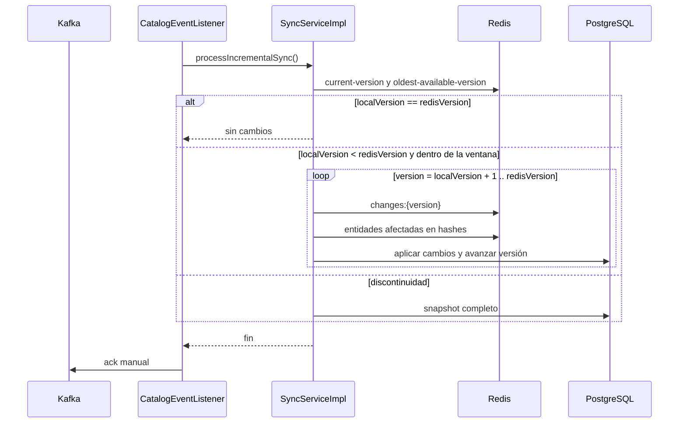

# Estrategia de sincronización

## 1. Principios

- Kafka notifica cambios; no contiene el catálogo.
- Redis publica el estado actual y la ventana de cambios incrementales.
- La API REST de la catedra entrega snapshots completos.
- PostgreSQL conserva la copia local y la versión aplicada.
- La versión local solo avanza cuando la unidad de trabajo termina correctamente.
- Las búsquedas nunca consultan a la catedra.

## 2. Configuración derivada

Los valores de integración se configuran por variables de entorno. Cuando no se informan de forma explícita, se derivan de `CATEDRA_GROUP_ID`:

| Propiedad | Valor derivado |
| --- | --- |
| `catedra.integration.kafka-catalog-topic` | `catedra.catalog.{groupId}` |
| `catedra.integration.kafka-consumer-group-id` | `alumnos-{groupId}` |
| `catedra.integration.redis-write-namespace` | `alumnos:{groupId}:*` |

Los valores explícitos tienen prioridad. El listener Kafka solo se registra si `kafka-enabled=true` y hay `groupId` o un topic explícito configurado.

Si `provisioningStatus` está informado y no es `PROVISIONED`, `SyncBootstrap` no ejecuta el snapshot inicial. Si el snapshot inicial falla, `SyncBootstrap` propaga el error y el servicio no queda disponible con una copia local incompleta.

## 3. Claves Redis consumidas

| Clave | Tipo | Uso |
| --- | --- | --- |
| `catedra:sync:current-version` | String decimal | Versión actual publicada. |
| `catedra:sync:oldest-available-version` | String decimal | Límite inferior de la ventana de cambios. |
| `catedra:sync:metadata` | Hash | Metadatos de publicación; la versión mínima disponible se lee de `catedra:sync:oldest-available-version`. |
| `catedra:sync:changes:{version}` | String JSON | IDs afectados por una versión. |
| `catedra:sync:professional-categories` | Hash | Categorías vigentes por ID. |
| `catedra:sync:professionals` | Hash | Profesionales vigentes por ID. |
| `catedra:sync:weekly-schedules` | Hash | Horarios vigentes por ID. |

Las claves de lectura se construyen con el prefijo configurado en `catedra.integration.redis-read-namespace` (`catedra:sync:*` por defecto) y los sufijos contractuales listados arriba.

## 4. Snapshot completo

### Cuándo se ejecuta

- Arranque con base local vacía y provisioning listo.
- Redis no está disponible.
- Redis no informa `current-version`.
- No hay versión local.
- `localVersion > redisVersion`.
- `localVersion < oldestAvailableVersion`.
- Falta `changes:{version}` o una entidad referenciada.
- JSON inválido, versión de cambio inconsistente o `dayOfWeek` inválido.
- Llamada manual a `POST /api/synchronization/snapshot`.

### Procedimiento

1. `syncSnapshot()` toma `ReentrantLock`.
2. Marca estado `SYNCING` y limpia el último error.
3. `CatedraApiClient` llama a `GET {apiBaseUrl}/api/synchronization/snapshot` con el JWT técnico.
4. Valida que exista `snapshotVersion`.
5. Dentro de una transacción:
   - borra horarios, profesionales y categorías;
   - inserta las tres colecciones del snapshot;
   - actualiza `catalog_versions` con `snapshotVersion`.
6. Marca estado `IDLE`.
7. Si falla, marca `ERROR`, guarda el mensaje y propaga la excepción.

## 5. Sincronización incremental

### Recepción del evento

`CatalogEventListener` consume `CatalogUpdated` y valida:

- `eventType == "CatalogUpdated"`;
- `schemaVersion == 1`;
- `eventId` no vacío;
- `eventId` no procesado previamente.

Si el evento es inválido o duplicado, se confirma el offset sin sincronizar. Si la sincronización falla, no se confirma el offset.

### Procedimiento

Para cada versión:

1. Se lee `changes:{version}`.
2. Se valida que `change.version`, si está presente, coincida con la clave.
3. Se cargan las entidades afectadas desde los hashes de Redis.
4. Se aplican categorías, profesionales y horarios en una transacción.
5. Se actualiza la versión local al final de esa transacción.

## 6. Reconciliación

`CatalogReconciliationJob` ejecuta `processIncrementalSync()` con:

- delay inicial: `30000` ms;
- delay fijo: `60000` ms;
- ambos configurables por variable de entorno.

Sirve para recuperar notificaciones Kafka perdidas. Solo actúa si la integración está configurada.

## 7. Matriz de fallos

| Situación | Acción |
| --- | --- |
| Evento duplicado | Se omite por `eventId`; se hace ack. |
| Redis caído | Snapshot REST. |
| Redis sin versión actual | Snapshot REST. |
| Sin versión local | Snapshot REST. |
| Versión local mayor que Redis | Snapshot REST. |
| Versión local menor que la ventana disponible | Snapshot REST. |
| Falta un cambio o una entidad | `CatalogDiscontinuityException` y snapshot REST. |
| JSON inválido | `CatalogDiscontinuityException` y snapshot REST. |
| Falla la sincronización desde Kafka | No se confirma el offset. |
| Falla la reconciliación | Se registra warning y se espera el próximo ciclo. |
| Catedra no disponible | `503 CATEDRA_UNAVAILABLE`; el estado local no se corrompe. |
| Falla el snapshot inicial | El arranque falla; no se sirve un catálogo vacío. |

## 8. Estado expuesto

`GET /api/synchronization/status` devuelve:

- versión local;
- versión actual de Redis;
- versión mínima disponible;
- última sincronización;
- último error;
- estado `IDLE`, `SYNCING` o `ERROR`.

El estado, el último error, la versión y `lastSyncedAt` se persisten en `sync_status`; al arrancar, un estado `SYNCING` interrumpido se convierte en `ERROR` con `recoverInterrupted()`.
